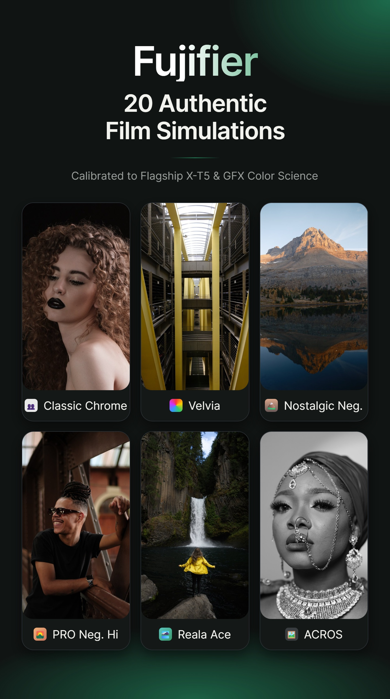
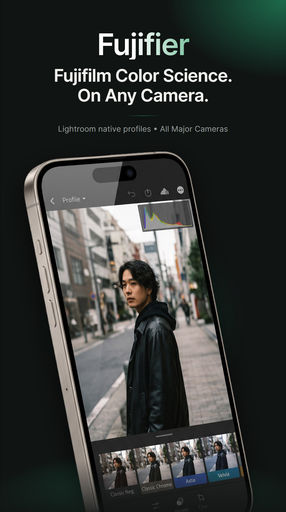
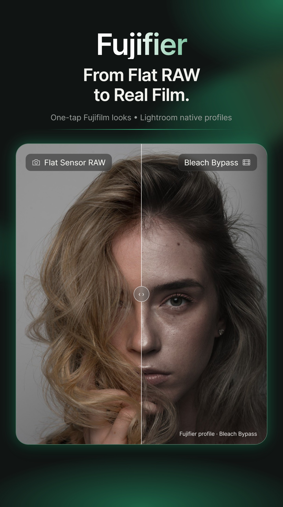
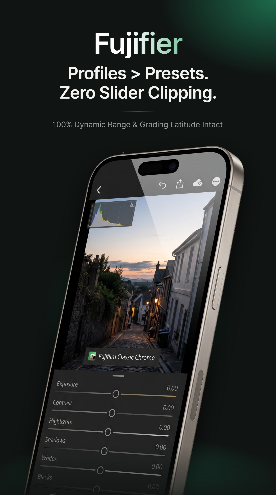
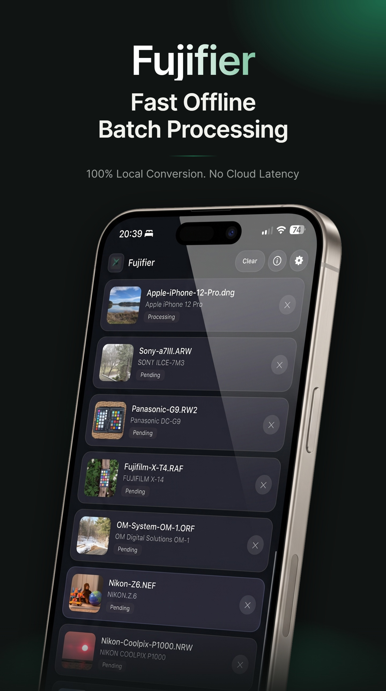

# Fujifier · Official AltStore Classic & SideStore Source

Official community repository source to install and automatically receive updates for **Fujifier** on iOS and iPadOS via [AltStore Classic](https://altstore.io) or [SideStore](https://sidestore.io).

[](altstore-classic://source?url=https%3A%2F%2Fraw.githubusercontent.com%2Fip-web%2Faltstore%2Fmain%2Fapps.json)
[](sidestore://source?url=https%3A%2F%2Fraw.githubusercontent.com%2Fip-web%2Faltstore%2Fmain%2Fapps.json)

> [!NOTE]
> **AltStore Classic vs. AltStore PAL**: Fujifier is a direct sideloaded app (IPA). It requires **AltStore Classic** (or SideStore) using personal or developer provisioning. The `altstore-classic://` deep link ensures it opens in AltStore Classic rather than AltStore PAL (which is restricted to notarized EU marketplace apps).

---

## 📱 Screenshots

<p align="center">
  
  &nbsp;
  
  &nbsp;
  
  &nbsp;
  
  &nbsp;
  
</p>

---

## 📲 How to Add this Source

### Option 1: One-Click Add
Tap the badges above on your iPhone or iPad, or click the direct deep link:
- **AltStore Classic**: [Add Fujifier to AltStore Classic](altstore-classic://source?url=https%3A%2F%2Fraw.githubusercontent.com%2Fip-web%2Faltstore%2Fmain%2Fapps.json)
- **SideStore**: [Add Fujifier to SideStore](sidestore://source?url=https%3A%2F%2Fraw.githubusercontent.com%2Fip-web%2Faltstore%2Fmain%2Fapps.json)

### Option 2: Manual Add
1. Copy the source URL:
   ```text
   https://raw.githubusercontent.com/ip-web/altstore/main/apps.json
   ```
   *(or the domain mirror: `https://fujifier.cc/altstore.json`)*
2. Open **AltStore Classic** or **SideStore** on your iOS device.
3. Navigate to **Sources** (top right **+** icon).
4. Paste the URL and tap **Add**.
5. Find **Fujifier** in your source list and tap **FREE / Install**.

---

## 📷 About Fujifier

Fujifier brings authentic medium format and 35mm Fujifilm color science (Classic Neg, Classic Chrome, ACROS, Reala Ace, Nostalgic Neg) to camera RAW files from **800+ camera bodies across Sony, Canon, Nikon, Lumix, Leica, Apple ProRAW, and Google Pixel**, with seamless 1-tap export directly into **Adobe Lightroom Mobile**.

- **Website**: [https://fujifier.cc](https://fujifier.cc)
- **GitHub**: [https://github.com/ip-web/Fujifier](https://github.com/ip-web/Fujifier)
